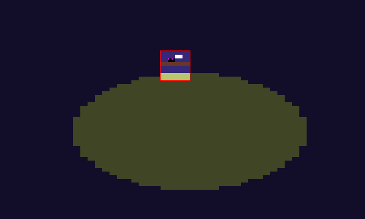

# c64lint

**Find out why your C64 picture won't convert - and the smallest fix.**

You drew a picture in Aseprite, Photoshop or GIMP for the C64. The converter
says *too many colours*, or picks a background colour you never meant, or
draws a red box and leaves you to guess. c64lint tells you:

- **which cells** break the multicolour or hires colour limit,
- **which colour** in each cell is the one too many,
- **the cheapest fix** - the fewest, least visible pixel changes - as a
  picture you can look at before you accept it,
- **which background colour ($d021)** suits the picture, ranked, with the
  cost of each choice,
- **which palette** you drew in, and every colour that is *nearly* right
  (the classic "same palette but wrong colours!" problem).

It is a checker, not a converter. When the picture is clean it hands it to
[png2prg](https://github.com/staD020/png2prg), or writes a Koala file itself.



*Overlay of `examples/02-bird-clash.png`: the broken cell framed red, the
surplus pixel marked magenta, everything that is fine dimmed.*

## First run

Download `c64lint-1.0.0.zip` from the
[releases page](https://github.com/turrican128/c64lint/releases) and unpack it.
It holds `c64lint.exe` (Windows), `c64lint` (Linux, x86-64), `c64lint.py` (the
same tool as Python source), this README and `examples/`. Nothing to install.

**Windows:** open a terminal in the unpacked folder (in Explorer: type `cmd`
in the address bar and press Enter) and run

```
c64lint.exe check examples\02-bird-clash.png --mode mc --overlay ov.png --fix fixed.png
```

In PowerShell type `.\c64lint.exe` instead of `c64lint.exe`.

**Linux:**

```
chmod +x c64lint
./c64lint check examples/02-bird-clash.png --mode mc --overlay ov.png --fix fixed.png
```

Then open `ov.png` (what is wrong) and `fixed.diff.png` (what the fix
changed). The examples below write `c64lint`; use whichever of the above fits
your system.

## Quick start

```
c64lint check examples/02-bird-clash.png --mode mc
```

```
[*] examples/02-bird-clash.png: 320x200 multicolour, palette pepto-pal (detected)
[*] background ranking: 6 blue (1 bad, cost 39.43), 7 yellow (1 bad, cost 39.43), 1 white (1 bad, cost 39.43), 2 red (1 bad, cost 39.43), 0 black (1 bad, cost 51.33)
[*] background: 6 blue (best)
[!] cell (28,3) at x=224 y=24: 6 blue x18, 7 yellow x8, 2 red x4, 0 black x1, 1 white x1; surplus: 0 black; fix repaints 1 C64 pixel(s)
[!] NOT CLEAN: 1 broken cell(s)
```

See what is wrong, and what the fix would change:

```
c64lint check pic.png --mode mc --overlay problems.png --fix fixed.png
```

`fixed.png` is your picture with the cheapest fix applied. `fixed.diff.png`
shows BEFORE (left) and AFTER (right), labelled: everything the fix left alone
is grey, every cell it touched is framed magenta (visible even as a
thumbnail), and a zoom underneath shows just the changed area, magnified up
to 16x, with every changed pixel outlined or ringed in magenta. The console
says how many pixels and cells changed.

**Your picture is never written to.** Every output path is checked before
anything is written: one that names your input - by any spelling, a
different case, a UNC or `\\?\` path, a hardlink, an NTFS stream
(`pic.png:x`) - is refused, as are two outputs on the same file, Windows
device names (`CON`, `NUL`, `COM1` ...) and a folder that does not exist.

**All outputs or none.** Every output is built in memory first and only
written when all of them are ready, so a run that stops with exit code 2
leaves no half-written set behind and does not touch older outputs. (Exit
code 3, png2prg failing, comes after c64lint's own outputs were written.)

Then build it:

```
c64lint check pic.png --mode mc --fix fixed.png --kla pic.kla
c64lint check pic.png --mode mc --fix fixed.png --then png2prg -- -d -o pic.prg
```

## What it checks, in order

1. **Palette.** Matches every colour against 15 known C64 palettes (the ones
   VICE ships, plus Colodore) and picks the closest. Colours that are not an
   exact palette entry are reported with their nearest C64 colour and how far
   off they are (CIE dE). Force one with `--palette`; list them with
   `c64lint palettes`. All the palettes number their 16 colours the same way,
   so a colour that is exact in *any* of them keeps its number when you force
   another one. When two different input colours end up as the same C64
   colour, the report says so.
2. **Pixel pairs** (multicolour at 320 wide). Multicolour pixels are two
   screen pixels wide. A pair with two different colours is a hires pixel
   that slipped in.
3. **Background.** All 16 colours are tried; each costs whatever fixing the
   whole picture with it would cost. The ranking is printed; the cheapest is
   used unless you give `--bg N`. A single broken cell can often be "fixed" by
   choosing one of its own colours as background - if the ranking surprises
   you, that is usually why, and `--bg` puts you in charge. When the cheapest
   background is not the colour covering most of the picture, c64lint says so
   and tells you how many cells would need fixing with that colour instead:

   ```
   [*] background: 2 red (best)
   [!] background 2 red was picked because it is the cheapest, but 6 blue covers 51% of the picture. If blue is meant to be the background, run again with --bg 6: then 7 cell(s) need fixing
   ```
4. **Cells.** Multicolour: each 4x8 cell may hold the background + 3 colours.
   Hires: each 8x8 cell may hold 2 colours.

**What "cost" means.** Every pixel the fix would repaint adds how far its
colour moves, as the eye sees it (CIE dE: about 2 is barely visible, 20 is a
different colour). A cell's cost is that sum for its cheapest fix; a
background's cost is the sum over the whole picture. 0 means the picture is
legal with that background as drawn. Ties are common: on a clean picture
every background that fits costs 0, and then the colour covering most of the
picture wins.

**Colour numbers** are the C64's own:

| | | | | | | | |
|---|---|---|---|---|---|---|---|
| 0 black | 1 white | 2 red | 3 cyan | 4 purple | 5 green | 6 blue | 7 yellow |
| 8 orange | 9 brown | 10 light red | 11 dark grey | 12 grey | 13 light green | 14 light blue | 15 light grey |

## How the fix decides

For a broken cell, every allowed set of colours is tried and the one with the
smallest total *visible* change wins. Visible means the colour difference as
the eye sees it (CIE Lab), not raw RGB, so a stray dark blue turns dark grey,
not yellow. Each removed pixel goes to its nearest kept colour.

- Cells without a colour clash are only touched to snap off-palette colours
  and to resolve split pixel pairs; their colour choice is never changed.
- No dithering is added.
- Same input, same options: byte-identical output.
- A fix only uses colours already in the cell, plus the background colour,
  which every multicolour cell can show anyway (bit pair 00). Repainting a
  stray pixel to the background is often the cheapest fix.

Pixel counts in the report are C64 pixels (one multicolour pixel = two screen
pixels).

## Options

| Option | |
|---|---|
| `--mode mc` / `--mode hires` | Required. Multicolour takes 160x200 or 320x200, hires 320x200 |
| `--palette NAME` | Use this palette instead of detecting one |
| `--bg N` | Background colour 0-15 (multicolour only). Skips costing the other 15, which is much faster on busy pictures |
| `--overlay OUT.png` | Problems drawn over your picture, 5x size |
| `--json OUT.json` | Everything in the report, machine-readable |
| `--fix OUT.png` | Cheapest fix, plus `OUT.diff.png`: before/after with changed cells framed and a zoom of the changed area |
| `--kla OUT.kla` | Koala file (multicolour). Written only from a clean result |
| `--then png2prg -- ARGS` | Run png2prg with ARGS on the clean result (`--then=png2prg` works too). png2prg reads 320x200 only, so a 160-wide picture is handed over as a pixel-doubled temporary copy |

"Clean result" means: your picture if it passed, otherwise the `--fix`
picture. Without `--fix` a picture that fails gets no Koala file and no png2prg
run - c64lint never builds from something it just told you is broken.

**png2prg** is not included: get it from
[github.com/staD020/png2prg](https://github.com/staD020/png2prg) (one file per
system) and put it in a folder on your PATH. If c64lint cannot find it, it
says so before writing anything (exit code 2).

Exit codes: `0` clean, `1` problems found (even if `--fix` fixed them), `2`
bad input or bad options (nothing written), `3` png2prg failed. Use it in a
makefile in front of png2prg. Options must be spelled out in full
(`--mode`, not `--mo`).

### The JSON report

`version`, `tool`, `file`, `notes` (every `[!]` warning that is not about one
cell or colour: background hint, merged colours, animated PNG ...), `mode`,
`palette`, `bg` (null in hires), `bg_ranking` (all 16 backgrounds, cheapest
first; just the one you gave when `--bg` is used), `off_palette`, `pairs`,
`cells`, `clean`. Colour numbers are integers everywhere except the keys of
`cells[].colours`, which JSON forces to be strings (`"6": 18`).

## Input

PNG only: RGB, RGBA, greyscale (8 or 16 bit) or indexed. Transparent pixels
are refused - the C64 has no transparency, so flatten onto your background
first. A picture with more than 256 different colours is refused too: that
is a photo or a scaled image, so convert it to C64 colours first (Dithertron,
Retropixels) and check the result. An animated PNG is checked on its first
frame, with a warning.

## Examples

`examples/` has five small pictures, each broken in one typical way. Try:

```
c64lint check examples/02-bird-clash.png --mode mc --overlay ov.png --fix fixed.png
```

## Not (yet) covered

FLI/AFLI, sprites, charsets, reading .kla/.art files, writing hires files
(use `--then png2prg`).

## Install

See **First run** at the top: the release zip needs no installation. To run
the source instead, use Python 3.10+ with Pillow:

```
pip install pillow
python c64lint.py check pic.png --mode mc
```

## Credits

Code: DR.J/Delysid. Palette values from the palette files shipped with
[VICE](https://vice-emu.sourceforge.io/), and Colodore by Pepto. png2prg by
Burglar - the tool to build your picture with once c64lint is happy.

MIT licence.
